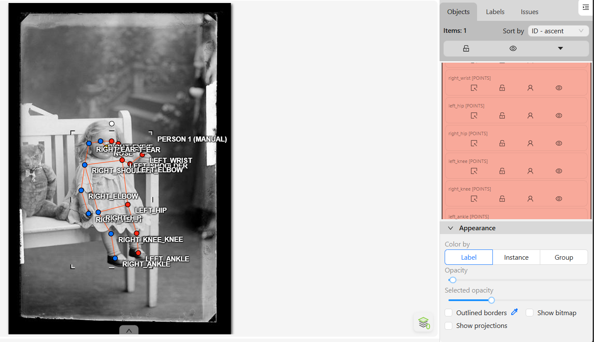
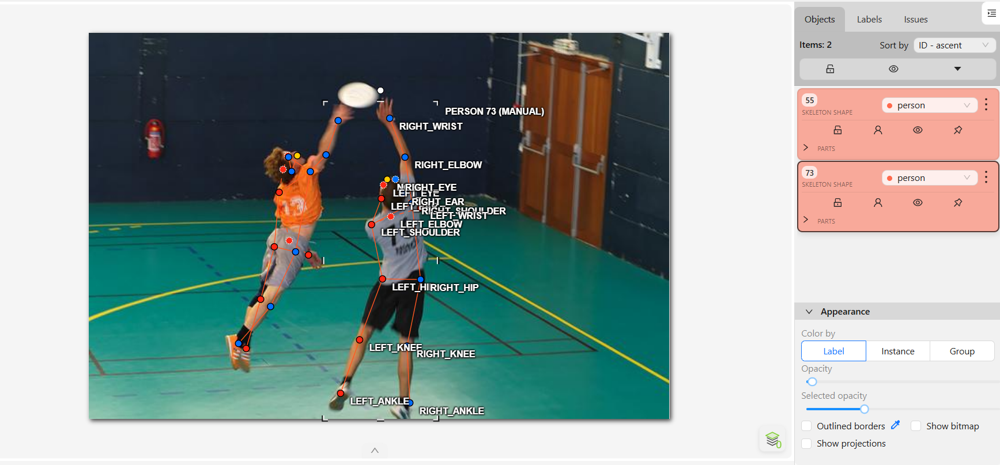
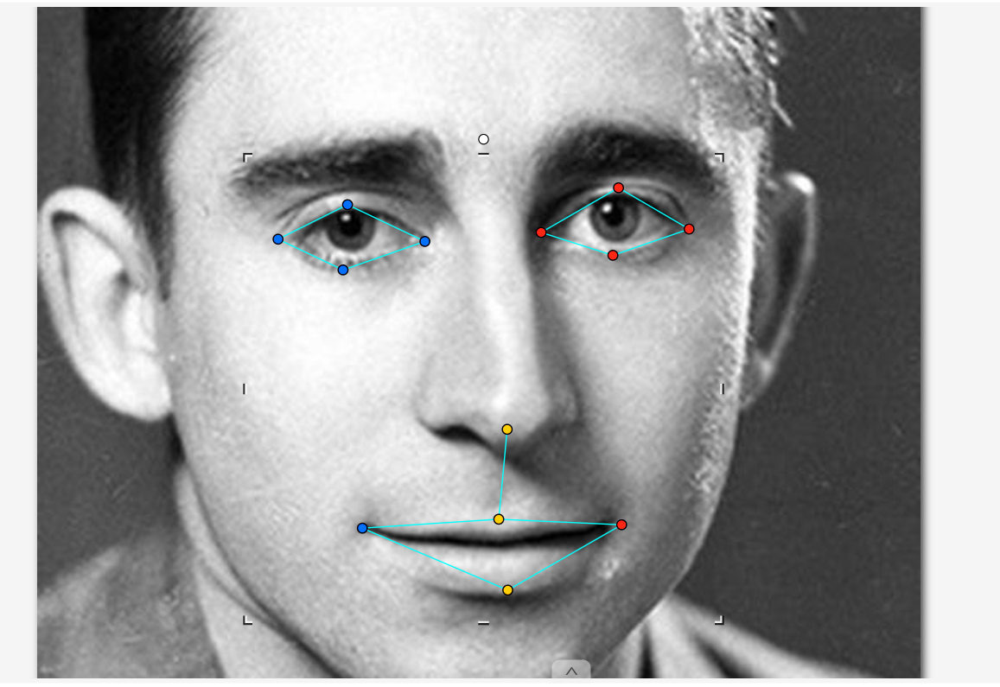
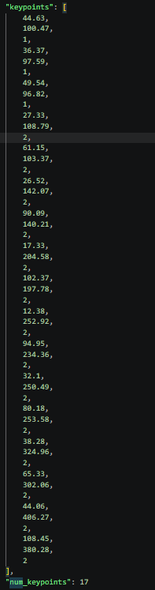

# Báo cáo cá nhân — Lưu Nhật Nam (2A202603243)

Dữ liệu: 12 ảnh người và 8 ảnh khuôn mặt cắt từ COCO 2017 (Lin et al., 2014), chỉ dùng trong lớp.

## 0. Thông tin học viên

- Họ tên: Lưu Nhật Nam
- MSSV: 2A202603243
- Email: 26ai.namln2@vinuni.edu.vn
- Link repository: https://github.com/LuuNhatNamm/K5-L2A-Day04-LuuNhatNam-2A202603243KeypointPose-Student.git
- Phiên bản CVAT (Help → About): 2.82.0
- Máy: hệ điều hành Windows · RAM 16 GB · chạy CVAT chế độ đầy đủ
- Bộ ảnh (`src/exports/assignment.json` do `lab.py setup` tạo): có
- Giờ bắt đầu: 17h
- Giờ kết thúc: 19h30

## 1. Kiểm tra label (CP0)

| Label | Kiểu | Số điểm | Tên điểm đúng bảng của lab? | Đúng thứ tự? | Số cạnh |
|---|---|---:|---|---|---:|
| `person` | Skeleton | 17 | Có | Có | 19 |
| `face` | Skeleton | 13 | Có | Có | 13 |

Mẫu `person` dựng theo người quay mặt về camera (các điểm `left_*` nằm bên phải khung mẫu)? Có. Các cặp điểm `left_*` nằm bên phải khung mẫu.

Cách đổi cờ `occluded` / `outside` cho **một điểm** trên CVAT 2.82.0: rê chuột vào đúng điểm, bấm `Q` để đổi `occluded` hoặc `O` để đổi `outside`.

## 2. Số lượng đã gán và thời gian (CP1, CP2)

| Nhóm ảnh | Số ảnh | Số skeleton đã gán | Số người dưới 60 px (không gán) | Số poster / gương / màn hình bỏ qua | Thời gian (phút) |
|---|---:|---:|---:|---:|---:|
| `easy` | 5 | 5 | Chưa ghi | Chưa ghi | Chưa ghi |
| `occluded` | 3 | 7 | Chưa ghi | Chưa ghi | Chưa ghi |
| `back` | 2 | 4 | Chưa ghi | Chưa ghi | Chưa ghi |
| `small` | 1 | 1 | Chưa ghi | Chưa ghi | Chưa ghi |
| `crowd` | 1 | 3 | Chưa ghi | Chưa ghi | Chưa ghi |
| `faces` | 8 | 8 | — | Chưa ghi | Chưa ghi |

- Tổng cộng đã gán 20 skeleton người trên 12 ảnh và 8 skeleton mặt trên 8 ảnh.
- Số ảnh người đã xong ở mốc phút 105: chưa ghi.
- Thời gian từ 17h đến 19h30 là 150 phút. Chưa ghi thời gian riêng cho CP1, CP2 và CP3.
- Ảnh tốn thời gian nhất và lý do: chưa có ghi chép thực tế để xác nhận.
- Số người dưới 60 px, số đối tượng bỏ qua và thời gian từng nhóm cần đối chiếu với ghi chép lúc làm. File xuất chỉ ghi các đối tượng đã gán.

## 3. Bảng ca khó (CP1, CP2)

Mỗi điểm bạn phân vân một dòng, nhất là phân vân giữa `v = 1` và `v = 0`, hoặc không chắc hướng người.

| Ảnh | Người / mặt | Điểm | Cờ đã chọn | Phân vân giữa | Lý do chọn |
|---|---|---|---:|---|---|
| | | | | | |
| | | | | | |
| | | | | | |

## 4. Bảng tự review (CP3)

Đi từ ảnh cuối về ảnh đầu. 5 ảnh người (ít nhất 2 ảnh `back` hoặc `crowd`) và 3 ảnh mặt. Ít nhất 8 dòng, kể cả dòng `ok`. Ghi lỗi trước, sửa sau.

Mã lỗi dùng đúng một trong: `lr_swap`, `vis_flag`, `position`, `missing`, `extra`, `ok`.

| Ảnh | Người / mặt | Điểm | Mã lỗi | Ghi chú | Đã sửa? |
|---|---|---|---|---|---|
| | | | | | |
| | | | | | |
| | | | | | |
| | | | | | |
| | | | | | |
| | | | | | |
| | | | | | |
| | | | | | |

Tổng hợp số lỗi theo mã:

| `lr_swap` | `vis_flag` | `position` | `missing` | `extra` | `ok` |
|---:|---:|---:|---:|---:|---:|
| | | | | | |

Điểm còn phân vân giữa `v = 1` và `v = 0` (ghi cả hai lựa chọn và lý do chọn):

...

## 5. Kiểm file xuất và kết quả tự kiểm (CP4)

Tự kiểm tay trong file JSON:

| File | Người / mặt kiểm (ảnh, thứ tự) | Số phần tử `keypoints` | Điểm `outside` ra `v = 0`, `occluded` ra `v = 1`? | `num_keypoints` khớp? |
|---|---|---:|---|---|
| `LuuNhatNam_persons.zip` | `000000189365.jpg`, #1 | 51 | `v=0`: 2, `v=1`: 1, `v=2`: 14 | Có, 15 |
| `LuuNhatNam_persons.zip` | `000000072098.jpg`, #1 | 51 | `v=0`: 0, `v=1`: 1, `v=2`: 16 | Có, 17 |
| `LuuNhatNam_faces.zip` | `face_219250.jpg`, #1 | 39 | `v=0`: 0, `v=1`: 8, `v=2`: 5 | Có, 13 |

CVAT 2.82.0 xuất `occluded` thành `v = 1` và `outside` thành `v = 0`. Cả 33 điểm `v = 0` trong file người vẫn giữ tọa độ cũ.

Hai job chính đã chuyển sang Completed trên CVAT. Job người là [#11](http://localhost:8080/tasks/11/jobs/11) và job mặt là [#12](http://localhost:8080/tasks/12/jobs/12).

```text
----- TÓM TẮT (dán vào báo cáo mục 5) -----
- File person: LuuNhatNam_persons.zip
  Số ảnh: 12 · số skeleton `person`: 20 · mỗi annotation 51 số
  Skeleton theo ảnh: 000000072098=1, 000000156986=2, 000000163118=2, 000000189365=2, 000000297227=2, 000000336477=1, 000000343057=1, 000000349521=1, 000000438099=1, 000000451084=1, 000000461389=3, 000000522889=3
  Cờ v: v=2 257 (76%) · v=1 50 (15%) · v=0 33 (10%)
  num_keypoints trung bình: 15.3
- File face: LuuNhatNam_faces.zip
  Số ảnh: 8 · số skeleton `face`: 8 · mỗi annotation 39 số
  Skeleton theo ảnh: face_105668=1, face_122747=1, face_125051=1, face_219250=1, face_257657=1, face_333134=1, face_356144=1, face_504911=1
  Cờ v: v=2 96 (92%) · v=1 8 (8%) · v=0 0 (0%)
  num_keypoints trung bình: 13.0
- Ghi chú: 33 điểm v = 0 vẫn mang tọa độ cũ (CVAT 2.x xuất như vậy; chuẩn COCO ghi 0, 0). Không phải lỗi: điểm v = 0 bị bỏ qua khi huấn luyện và khi chấm.
- Số [LỖI]: 0 · số [CẢNH BÁO]: 4
Kết quả: ĐẠT (đọc lại từng cảnh báo ở trên)
```

Các cảnh báo cần đối chiếu với ảnh gốc. Script đánh dấu cặp khớp có vị trí trái/phải bất thường. Đối chiếu từng trường hợp dưới đây với ảnh trong CVAT và ghi lý do giữ nguyên hoặc kết quả sửa.

```text
[CẢNH BÁO] 000000163118.jpg #1: cặp ankle nằm ngược phía so với các cặp còn lại. Có thể đổi trái/phải một cặp (`lr_swap`), hoặc tay / chân bắt chéo thật: kiểm lại.
[CẢNH BÁO] 000000163118.jpg #2: cặp wrist nằm ngược phía so với các cặp còn lại. Có thể đổi trái/phải một cặp (`lr_swap`), hoặc tay / chân bắt chéo thật: kiểm lại.
[CẢNH BÁO] 000000189365.jpg #1: cặp wrist nằm ngược phía so với các cặp còn lại. Có thể đổi trái/phải một cặp (`lr_swap`), hoặc tay / chân bắt chéo thật: kiểm lại.
[CẢNH BÁO] 000000522889.jpg #3: cặp wrist, ankle nằm ngược phía so với các cặp còn lại. Có thể đổi trái/phải một cặp (`lr_swap`), hoặc tay / chân bắt chéo thật: kiểm lại.
```

Đối chiếu ảnh và tọa độ trong ZIP bằng Codex:

| Ảnh và người | Quan sát | Đề xuất |
|---|---|---|
| `000000163118.jpg` #1 | Hai chân người áo cam chồng nhau khi nhảy, hai mắt cá rất gần nhau trong ảnh. | Rà đường nối từ hông qua gối tới mắt cá. Cảnh báo theo trục ngang chưa đủ để kết luận cần đảo. |
| `000000163118.jpg` #2 | Người áo xám quay lưng, cánh tay đưa lên cao và cổ tay vượt qua trục thân trên ảnh. | Kiểm từ vai tới khuỷu và cổ tay. Tư thế giơ tay giải thích được cảnh báo vị trí ngang. |
| `000000189365.jpg` #1 | Vận động viên áo trắng xoay người và cầm vợt bằng hai tay, hai cổ tay ở sát nhau. | Kiểm đường nối từ từng khuỷu tới tay cầm vợt trước khi quyết định đổi nhãn. |
| `000000522889.jpg` #3 | Vận động viên ở tiền cảnh đưa hai tay sang cùng phía. Chân gập ra sau, mắt cá của chân gập nằm phía trái ảnh. | Kiểm theo từng chi. Hai cổ tay và hai mắt cá có thể đổi thứ tự ngang do tư thế. |

Các ghi chú trên dựa vào ZIP hiện tại. Việc sửa hay giữ nguyên cần được học viên xác nhận trên CVAT.

## 6. Ảnh chụp màn hình

1. Label `person` trong label constructor (đủ 17 điểm có tên):

   

   Nguồn: CVAT local, label constructor của lab.

2. Một người quay lưng đã gán, cờ đã đặt:

   

   Nguồn: COCO 2017, ảnh người trong Job 11.

3. Một khuôn mặt đã gán 13 điểm, phóng to vùng mắt:

   

   Nguồn: COCO 2017, ảnh khuôn mặt trong Job 12.

4. Một đoạn JSON xuất của một người:

   

   Nguồn: JSON COCO Keypoints 1.0 xuất từ Job 11 trên CVAT local, dùng ảnh COCO 2017.

## 7. Tự đánh giá

1. Lỗi bạn mắc nhiều nhất hôm nay, và cách bạn sẽ tránh ở dự án thật:

   - không có

2. Một quy tắc bạn đề xuất thêm vào guideline (kèm ảnh ví dụ nếu có):

    - không có
3. Nhãn của bạn đi vào model ở đâu? Chọn một lỗi bạn đã sửa và nói nó sẽ làm model học sai thế nào (heatmap, trọng số trong loss, hay bước lật ảnh):


## 8. Khó khăn và lỗi kỹ thuật

Lúc 19:16 ngày 12/11/2026, VS Code báo R Language Server không khởi động vì đường dẫn tới chương trình R bị rỗng (`ERR_INVALID_ARG_VALUE`). Kết quả kiểm tra các ZIP của lab bằng script Python vẫn là ĐẠT. Chưa có thông tin về lỗi kỹ thuật khác trong CVAT hoặc lúc xuất ZIP.

## Bonus (nếu làm)

### B1 — 3 ảnh người khó thêm

| Ảnh | Số skeleton | Số người dưới 60 px | Ca khó nhất |
|---|---:|---:|---|
| `000000254060.jpg` | 2 | Chưa xác nhận | Hai người trên xe chồng lên nhau, khó theo dõi tay và chân của người ngồi sau. |
| `000000465508.jpg` | 3 | Chưa xác nhận | Hai người ở tiền cảnh chồng nhau, người trượt ván ở xa chiếm ít pixel. |
| `000000517702.jpg` | 3 | Chưa xác nhận | Ô che vùng đầu và vai, hai người đi sát nhau. |

Job bonus người [#13](http://localhost:8080/tasks/13/jobs/13) đã Completed.

```text
----- TÓM TẮT (dán vào báo cáo mục 5) -----
- File person: LuuNhatNam_bonus_persons.zip
  Số ảnh: 3 · số skeleton `person`: 8 · mỗi annotation 51 số
  Skeleton theo ảnh: 000000254060=2, 000000465508=3, 000000517702=3
  Cờ v: v=2 95 (70%) · v=1 24 (18%) · v=0 17 (12%)
  num_keypoints trung bình: 14.9
- File face: LuuNhatNam_bonus_faces.zip
  Số ảnh: 5 · số skeleton `face`: 5 · mỗi annotation 39 số
  Skeleton theo ảnh: face_280788=1, face_300200=1, face_344941=1, face_45276=1, face_494518=1
  Cờ v: v=2 65 (100%) · v=1 0 (0%) · v=0 0 (0%)
  num_keypoints trung bình: 13.0
- Ghi chú: 17 điểm v = 0 vẫn mang tọa độ cũ (CVAT 2.x xuất như vậy; chuẩn COCO ghi 0, 0). Không phải lỗi: điểm v = 0 bị bỏ qua khi huấn luyện và khi chấm.
- Số [LỖI]: 0 · số [CẢNH BÁO]: 0
Kết quả: ĐẠT
```

### B2 — 5 ảnh khuôn mặt đen trắng / hồng ngoại

Job bonus mặt [#14](http://localhost:8080/tasks/14/jobs/14) đã Completed. File xuất có 5 ảnh, mỗi ảnh một skeleton 13 điểm. Cả 65 điểm được xuất với `v = 2`. Nhận xét kỹ thuật của Codex: ảnh không màu làm mất dấu hiệu phân biệt theo màu da, môi và gọng kính. Khi đặt điểm, dựa vào đường viền và độ tương phản tại mí, khóe mắt và khóe miệng. Trong ảnh hồng ngoại, nếu thấy rõ điểm mắt qua tròng kính thì dùng `v=2`. Nếu điểm bị che nhưng ước lượng chắc thì dùng `v=1`. Nếu không xác định được thì dùng `v=0`.

### B3 — Model so với nhãn của tôi (không tính điểm)

- Demo đã dùng:
- Ảnh đã thử:

1. Model có trả điểm cho khớp bị che, hay khớp ngoài ảnh không? Confidence ở các điểm đó thế nào?

   ...

2. Với người quay lưng, model có đổi trái/phải không?

   ...

3. Bộ điểm của model có giống 17 điểm COCO không?

   ...

## 9. Tài liệu tham khảo và công cụ AI đã dùng

- Nguồn ảnh và quy ước nhãn trong [README](../../README.md), [Guideline](../../docs/GUIDELINE.md) và [nguồn dữ liệu của lab](../../src/lab/NGUON_ANH.md).
- CVAT local 2.82.0 và `src/check_submission.py` dùng để kiểm tra dữ liệu đã lưu và các ZIP đã xuất.
  - Codex
